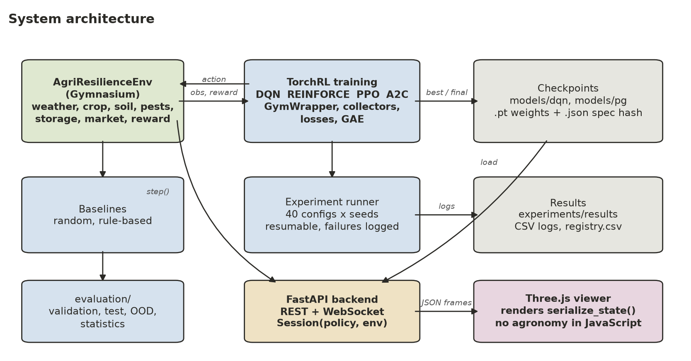
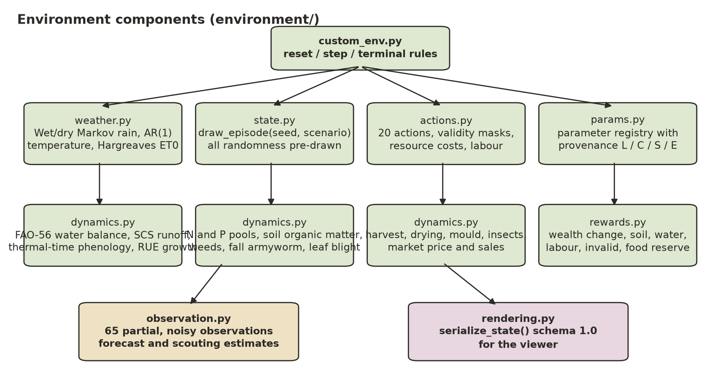
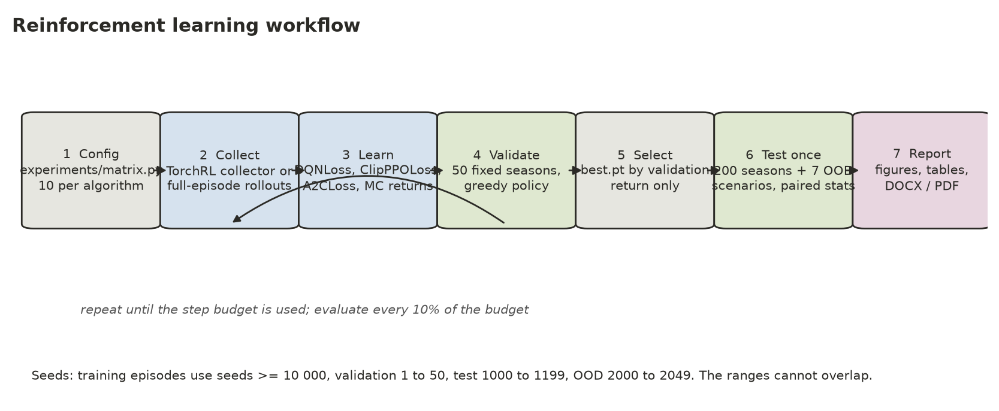
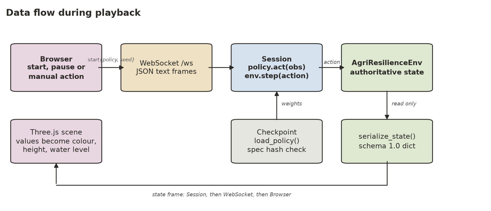

# Architecture

Four diagrams are in `docs/figures/` and are regenerated by `uv run main.py report` (`reporting/diagrams.py`).

| Diagram | File |
|---|---|
| System architecture | `docs/figures/arch_system.png` |
| Environment components | `docs/figures/arch_environment.png` |
| RL workflow | `docs/figures/arch_workflow.png` |
| Data flow during playback | `docs/figures/arch_dataflow.png` |

## Why the environment is plain Gymnasium and the learners use TorchRL

`AgriResilienceEnv` subclasses `gymnasium.Env` and has no dependency on TorchRL or PyTorch. That keeps one authoritative
simulator that the tests, the baselines, the evaluator, the backend and the four learners all call in the same way.

TorchRL enters at the learner boundary:

* `torchrl.envs.GymWrapper(AgriResilienceEnv(), categorical_action_encoding=True)` turns the Gymnasium env into a TorchRL
  `EnvBase` with `TensorDict` observations and a `Categorical` action spec.
* DQN uses `QValueActor`, `EGreedyModule`, a `ReplayBuffer` with `LazyTensorStorage`, `DQNLoss` (Huber, optional double DQN,
  delayed target network) and `SoftUpdate` or `HardUpdate`.
* PPO uses `ProbabilisticActor` and `ValueOperator`, `GAE`, `ClipPPOLoss` and a `ReplayBuffer` with `SamplerWithoutReplacement`
  for minibatches.
* A2C uses the same actor and critic, `GAE` and `A2CLoss`, with one gradient step per short rollout.
* REINFORCE uses the TorchRL env wrapper, `env.rollout` and `ProbabilisticActor` for sampling. TorchRL has no loss for a pure
  Monte-Carlo policy gradient without a learned value function, so the loss `-(log pi(a|s) * (G_t - b)).mean()` is written out in
  `agents/reinforce.py`. `G_t` is the discounted return to go from the real rewards of whole episodes.

Gymnasium owns the **problem** (what the world does); TorchRL owns the **solution machinery** (collecting data and computing losses).
The observation spec hash joins them: every checkpoint stores the hash of `environment/observation.py` and refuses to load if it changed.

## Environment components

Randomness is drawn once per episode in `draw_episode(seed, scenario)` and does not depend on actions. Two policies that face the
same seed see the same rain, temperatures, pest flights, prices and labour shocks (common random numbers). This is what makes the
paired tests in the report valid and makes a replay in the viewer identical to the season that was scored.

## Training and evaluation workflow

Seed ranges: training episodes use seeds from 10 000 up (the default draw), validation uses 1 to 50, test uses 1000 to 1199 and
out-of-distribution scenarios use 2000 to 2049. `tests/test_agents.py` checks that these cannot overlap.
Validation chooses `best.pt` inside a run and the configuration within an algorithm. The test seasons and the seven OOD scenarios are
scored only for the selected configuration of each algorithm (`evaluation/final_eval.py`).

## Checkpoint loading and playback

`agents/loader.py` is the only way a trained network is read.

1. `<tag>.pt` holds the weights; `<tag>.json` holds the algorithm, layer sizes, activation, training config, step, validation return,
   environment version and observation-spec hash.
2. `load_policy(path)` checks the hash and the observation and action sizes, builds the same MLP (`agents/common.make_net`), loads the
   weights with `weights_only=True`, and returns a `CheckpointPolicy` with `act(obs)`.
3. Playback is greedy: `argmax` over Q-values (DQN) or action logits (REINFORCE, PPO, A2C). No exploration noise, in eval mode.
4. `play.py`, `evaluation/evaluator.py` and `backend/session.py` all call that function, so what the terminal prints, what the tables
   report and what the browser draws come from the same policy and the same episode.

## Data flow while the viewer runs

The WebSocket message formats and the full state schema are in [API.md](API.md). The JavaScript in `frontend/src/` reads values such as
`plots[i].canopy_retained`, `plots[i].stress`, `resources.water_m3` and `storage.bags` and turns them into leaf colour, plant height, the
water level in the pan and the number of sacks by the granary. It contains no growth, water balance, pest, price or reward model.
`tests/test_backend.py` compares the HTTP episode with a direct rollout of the Gymnasium env.
